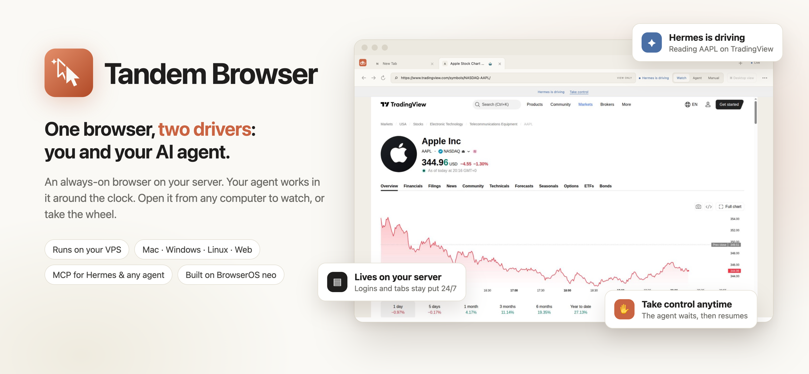
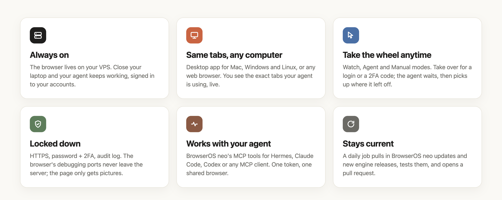
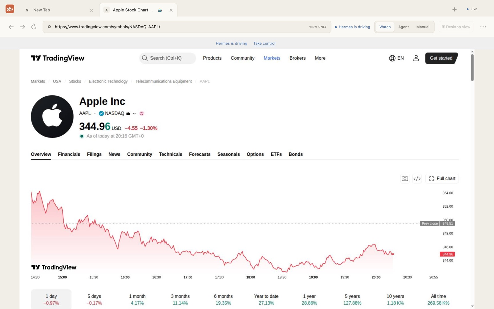
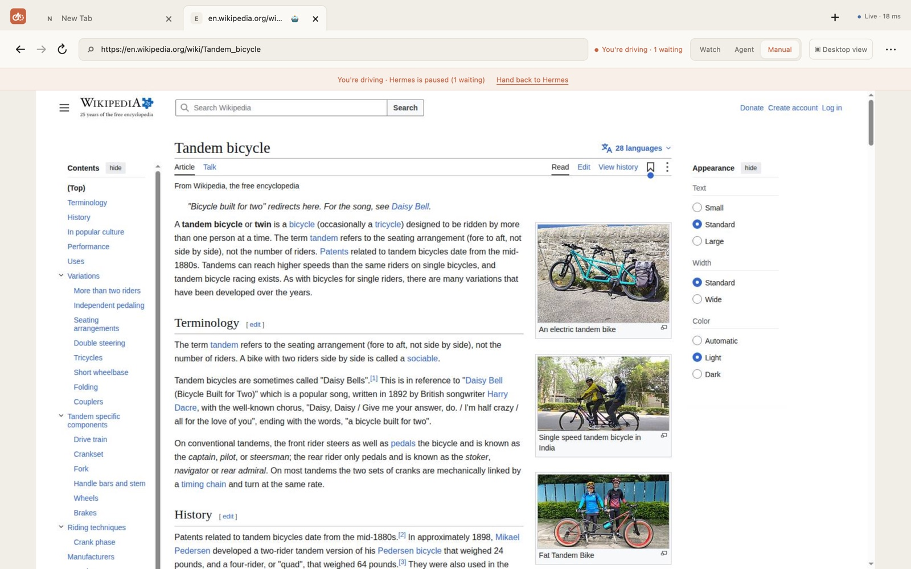
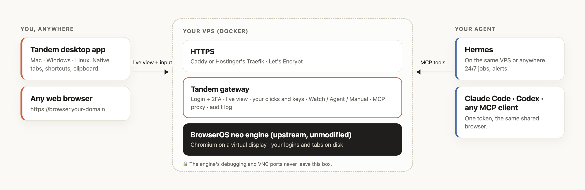

<p align="center">
  
</p>

<p align="center">
  <b>Your browser lives on your server. Your AI agent drives it around the clock.<br>
  Open it from any computer to watch, or take the wheel.</b>
</p>

<p align="center">
  <a href="#install-it-with-your-agent"><b>Copy the install prompt</b></a> ·
  <a href="#install-by-hand"><b>Install by hand</b></a> ·
  <a href="#desktop-app"><b>Desktop app</b></a> ·
  <a href="#connect-your-agent"><b>Connect your agent</b></a> ·
  <a href="../UPSTREAM.md"><b>How it stays up to date</b></a>
</p>

<p align="center"><sub>A fork of <a href="https://github.com/browseros-ai/BrowserOS">BrowserOS neo</a> · AGPL-3.0 · Linux VPS (amd64/arm64) · desktop app for macOS, Windows, Linux</sub></p>

## Why Tandem

AI agents are good at the boring parts of the web: checking dashboards, reading
inboxes, pulling numbers. But they need a real, signed-in browser, and they need
it all day, not just while your laptop is open. Tandem puts that browser on your
server and lets you share it with your agent.

<p align="center">
  
</p>

## See it

The agent opens a page; you watch it live. Press **Manual** and the agent pauses
while you click, type and scroll. Hand back, and it carries on. These are real
screenshots from a Tandem server.

| Hermes is driving (Watch mode) | You took the wheel (Manual mode) |
| --- | --- |
|  |  |

| Mode | Who drives | What you see |
| --- | --- | --- |
| **Watch** | Your agent | The tab your agent is working in, followed automatically |
| **Agent** | Your agent | Any tab you pick, view only |
| **Manual** | You | Full control; the agent's browser actions wait until you hand back |

## How it connects

<p align="center">
  
</p>

Tandem doesn't rebuild Chromium. It runs BrowserOS neo's official engine image
unchanged and adds a small gateway in front of it: login with 2FA, the live view,
your clicks and keys, the control modes and an MCP proxy. Only that gateway can
reach the browser; its debugging ports never leave the server.

<a id="install-it-with-your-agent"></a>

## Install it with your agent

Paste this into **Claude Code**, **Codex** or another coding agent on your own
computer. It asks you a few questions, sets up the server, and checks it works.
You need a Linux VPS (2 vCPU and 4 GB RAM or more) you can SSH into as root, or a
Hostinger VPS plus a Hostinger API token.

```text
Install Tandem Browser for me: an always-on BrowserOS neo browser on my Linux
VPS that my AI agent drives over MCP and that I can watch or control from my own
computer. Repository: https://github.com/Samin12/tandem-browser
Read these first: README (.github/README.md), tandem/deploy/README.md,
tandem/docs/HERMES.md and tandem/docs/SECURITY.md.

1. Interview me before touching anything. Ask, one short question at a time:
   - How do you reach the server: SSH (host, user, key) or a Hostinger API token?
   - Which domain or subdomain should Tandem use? (Hostinger Docker + Traefik
     VPSes can use https://tandem.<server>.hstgr.cloud with no DNS work.)
   - An email for Let's Encrypt.
   - Which agent will drive the browser: Hermes, Claude Code, Codex, or other?
     Where does it run: on this VPS or somewhere else?
   - Do you want 2FA (TOTP) on the login? (Recommend yes.)
   Never ask me to paste passwords into chat; generate secrets yourself.
   Then make a folder ~/tandem-setup/ on my computer with a notes.md that
   records my answers and every step you take.

2. Inspect the server read-only first: OS (Ubuntu 22.04/24.04 or Debian 12),
   CPU/RAM/disk, Docker, and what already listens on ports 80/443. Don't stop,
   remove or reconfigure anything that is already running there.

3. Install:
   - If Traefik already owns 80/443 (Hostinger's "Docker + Traefik" template),
     use tandem/deploy/hostinger/: run build-gateway.sh on the server, then
     create the Docker Manager project (or `docker compose up -d`) from
     tandem/deploy/hostinger/compose.yaml.
   - Otherwise clone the repo to /opt/tandem-browser and run
     tandem/deploy/install.sh (it installs Docker, a firewall and Caddy).
   Generate a strong login password, a TOTP secret and a 48-character agent
   token. Save them to ~/tandem-setup/credentials.md (chmod 600) on my computer,
   show me the password once, and give me the TOTP secret as an otpauth:// link
   (and a QR PNG in ~/tandem-setup/ if you can). Never commit secrets anywhere.

4. Verify from my computer, and show me the results:
   - https://<domain>/api/health returns ok, cdp and mcp all true.
   - https://<domain>/ redirects to /login; /mcp without the token returns 401.
   - Ports 6080, 9010, 9110 and 8790 are NOT reachable from the internet.
   - An MCP initialize + tools/list with the agent token works.

5. Connect my agent with tandem/docs/HERMES.md (Hermes) or as a streamable HTTP
   MCP server named "tandem" with header "Authorization: Bearer <token>"
   (Claude Code: `claude mcp add --transport http tandem https://<domain>/mcp
   --header "Authorization: Bearer <token>"`). Keep the token in that agent's
   env/secret store, not in config files in git. Install the tandem-browser
   skill from tandem/hermes/ for Hermes. Then ask the agent to open
   https://example.com in Tandem and confirm the tab shows up.

6. Tell me how to open it: the URL, how to log in with 2FA, and where to get
   the desktop app (GitHub Releases of the repository). Finish with a short
   summary of what was installed, where files live on the server, and how to
   update (`./tandem update` or build-gateway.sh + restart) and back up.
```

<a id="install-by-hand"></a>

## Install by hand

**Any Ubuntu/Debian VPS** (Caddy gets the HTTPS certificate):

```sh
# On the VPS, as root. Point your domain's A record at the VPS first.
apt-get update && apt-get install -y git
git clone https://github.com/Samin12/tandem-browser.git /opt/tandem-browser
cd /opt/tandem-browser/tandem/deploy
./install.sh          # asks for domain, email and password; sets up 2FA
```

**Hostinger VPS with the "Docker + Traefik" template:** build the gateway on the
VPS, then add `tandem/deploy/hostinger/compose.yaml` as a Docker Manager project
(or `docker compose up -d` in `/docker/tandem`). Your Tandem lives at
`https://tandem.<server>.hstgr.cloud`.

```sh
curl -fsSL https://raw.githubusercontent.com/Samin12/tandem-browser/main/tandem/deploy/hostinger/build-gateway.sh | bash
```

Full guide: [tandem/deploy/README.md](../tandem/deploy/README.md) (updates,
encrypted backups, logs, reboot recovery, troubleshooting).

<a id="desktop-app"></a>

## Desktop app

Download Tandem Browser for **macOS**, **Windows** or **Linux** from
[Releases](https://github.com/Samin12/tandem-browser/releases). On first launch,
enter your server address (for example `https://tandem.example.com`) and log in.
It's a thin window onto your server: native tabs, ⌘T / ⌘W / ⌘L shortcuts, and
copy and paste with the remote browser. The login stays signed in until your
session expires.

The macOS build isn't notarized yet. If macOS blocks it, open **System Settings →
Privacy & Security → Open Anyway**. No app? Any browser works:
`https://your-domain`.

<a id="connect-your-agent"></a>

## Connect your agent

Tandem speaks MCP through the gateway, with BrowserOS neo's browser tools
(`run`, `tabs`, `navigate`, `snapshot`, `act`, `read`, `screenshot` and more).

```yaml
# Hermes: ~/.hermes/config.yaml   (token in ~/.hermes/.env as TANDEM_AGENT_TOKEN)
mcp_servers:
  tandem:
    url: https://tandem.example.com/mcp
    headers:
      Authorization: Bearer ${TANDEM_AGENT_TOKEN}
```

```sh
# Claude Code
claude mcp add --transport http tandem https://tandem.example.com/mcp \
  --header "Authorization: Bearer $TANDEM_AGENT_TOKEN"
```

When you take Manual control, the agent's read-only tools keep working and
anything that changes the browser waits (up to two minutes) until you hand back.
Details: [tandem/docs/HERMES.md](../tandem/docs/HERMES.md).

## Safe by design

- HTTPS only, password + 2FA, rate-limited logins, sessions that expire.
- The agent token only opens `/mcp`; it can't log in to the viewer.
- The page you see receives pictures of the browser, never its cookies or
  storage, and can only send a fixed list of actions (click, type, navigate…).
- The engine's DevTools, MCP and VNC ports are never published.
- An audit log records logins, control changes and agent tool names, never what
  you type.

For trading research, the agent watches dashboards and uses paper accounts only;
see [tandem/docs/TRADING.md](../tandem/docs/TRADING.md). Full model:
[tandem/docs/SECURITY.md](../tandem/docs/SECURITY.md).

## Stays in sync with BrowserOS

Everything Tandem adds lives in [`tandem/`](../tandem) and
`.github/workflows/tandem-*.yml`; the rest of the repository is upstream
BrowserOS, untouched. Every day a workflow merges new BrowserOS commits, checks
for a newer engine image, runs the tests and opens a pull request. Safe updates
merge on their own once checks pass; risky ones wait for a person.
[How it works](../UPSTREAM.md) · [Changelog](../tandem/CHANGELOG.md)

## Docs

| | |
| --- | --- |
| [Architecture](../tandem/docs/ARCHITECTURE.md) | Research findings and design decisions |
| [Protocol](../tandem/docs/PROTOCOL.md) | Gateway, viewer and desktop app contract |
| [Deploy and operate](../tandem/deploy/README.md) | Install, update, back up, troubleshoot |
| [Hermes](../tandem/docs/HERMES.md) · [Security](../tandem/docs/SECURITY.md) · [Trading](../tandem/docs/TRADING.md) | |

## License and credits

Tandem Browser is licensed under the [AGPL-3.0](../LICENSE), like BrowserOS. It
is built on [BrowserOS](https://github.com/browseros-ai/BrowserOS) by the
BrowserOS team, which builds on [Chromium](https://www.chromium.org/) and
[ungoogled-chromium](https://github.com/ungoogled-software/ungoogled-chromium)
([notice](../LICENSE.ungoogled_chromium)). "BrowserOS" is that project's name;
Tandem Browser is an independent fork, not affiliated with or endorsed by it.
Upstream's own README is [here](../README.md).
