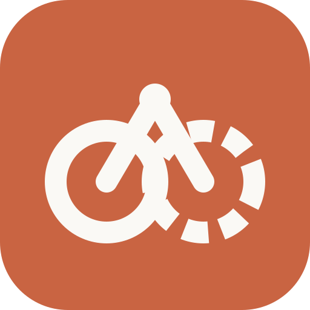

<div align="center">


# Tandem Browser

**One browser, two drivers: you and your agent.**

An always-on browser that runs on your server. Your AI agent (Hermes) drives it
around the clock; you watch it live or take the wheel from any computer.
</div>

---

Tandem Browser is a fork of [BrowserOS](https://github.com/browseros-ai/BrowserOS)
(BrowserOS neo, the browser for AI agents). It keeps the upstream engine as is
and adds what you need to run it on a VPS and share it:

- **Runs on a server.** The browser lives on your VPS in Docker, with your logins
  and tabs kept on its disk. Close your laptop; it keeps going.
- **One browser, everywhere.** Open the Tandem desktop app (Mac, Windows, Linux)
  or `https://browser.your-domain` and you see the exact tabs your agent is using.
  Click, type, scroll, switch tabs, use the address bar.
- **Built for agents.** Hermes (or any MCP client) connects to the same browser
  through BrowserOS neo's MCP tools.
- **Shared control.** Watch, Agent and Manual modes. Take over at any moment;
  the agent pauses and resumes when you hand control back.
- **Secure by default.** HTTPS, password + TOTP, the browser's debugging ports
  never exposed, audit log.
- **Stays current.** A daily job merges upstream BrowserOS changes and new
  engine releases, tests them, and opens a pull request.

## How it fits together

```
Mac / Windows app ─┐                       ┌─ Tandem gateway ── BrowserOS neo engine
any browser ───────┼── HTTPS ── your VPS ──┤   (auth, live view,     (upstream image,
Hermes (MCP) ──────┘                       │    control, MCP proxy)   unmodified)
```

## Docs

| | |
|---|---|
| [Install on a Hostinger VPS](../tandem/deploy/README.md) | Domain, one-command install, first login, backups |
| [Connect Hermes](../tandem/docs/HERMES.md) | MCP config and shared-control behaviour |
| [Architecture](../tandem/docs/ARCHITECTURE.md) | Research findings and design decisions |
| [Protocol](../tandem/docs/PROTOCOL.md) | Gateway, viewer and desktop contract |
| [Security](../tandem/docs/SECURITY.md) | Threat model and settings |
| [Trading research](../tandem/docs/TRADING.md) | What the agent may and may not do |
| [Upstream sync](../UPSTREAM.md) | How BrowserOS updates flow in |
| [Changelog](../tandem/CHANGELOG.md) | Imported upstream changes and Tandem changes |

## Where the code is

All Tandem code is in [`tandem/`](../tandem) and `.github/workflows/tandem-*.yml`.
Everything else is upstream BrowserOS, kept unchanged so upstream merges stay
clean. Upstream's own README is [`README.md`](../README.md).

## License and credits

Tandem Browser is licensed under the [AGPL-3.0](../LICENSE), like BrowserOS.
It is based on [BrowserOS](https://github.com/browseros-ai/BrowserOS) by the
BrowserOS team, which builds on [Chromium](https://www.chromium.org/) and
[ungoogled-chromium](https://github.com/ungoogled-software/ungoogled-chromium)
([notice](../LICENSE.ungoogled_chromium)). "BrowserOS" is the BrowserOS
project's name; Tandem Browser is an independent fork and is not affiliated
with or endorsed by it.
